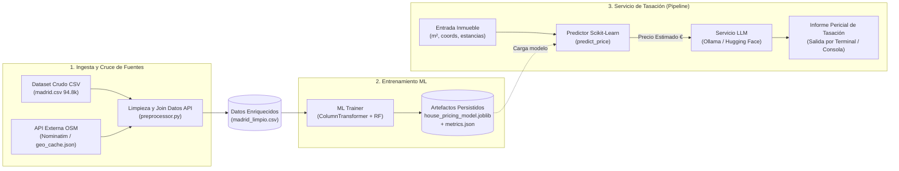

# Proyecto II - Automatización e Integración de Servicios
## Sistema de tasación y valoración inmobiliaria en Madrid

Este repositorio contiene la entrega del **Proyecto II** de la asignatura. El objetivo de la práctica es construir un pipeline completo para valorar viviendas en la Comunidad de Madrid. El sistema se encarga de tres tareas principales:

1. **Limpiar y enriquecer los datos**. Parte de un dataset con unas 94.800 viviendas en bruto, descarta filas con datos erróneos y consulta la API pública de OpenStreetMap (Nominatim) para asociar cada coordenada a su distrito y barrio real.
2. **Entrenar un modelo de Machine Learning**. Con Scikit-Learn, entrena un pipeline de regresión (`RandomForestRegressor` con transformadores de columnas) para estimar el precio de venta según los metros cuadrados, habitaciones, baños, ascensor y distrito.
3. **Generar un informe de tasación con IA**. Utiliza un modelo de lenguaje en local (Ollama con `gemma4:e2b` o similar) para que actúe como perito tasador y redacte por terminal una justificación del precio obtenido.

El proyecto está organizado de manera modular, gestionado con **`uv`** para que sea fácil de reproducir en cualquier ordenador, y pensado para usarlo como base en el **Proyecto III**.

---

## 1. Arquitectura del sistema y flujo de datos

Siguiendo el esquema visto en las clases teóricas (ingesta de fuentes, almacenamiento limpio, entrenamiento del modelo y pipeline de inferencia), el sistema se organiza en tres fases conectadas.



---

## 2. Instalación y configuración del entorno

Para gestionar las dependencias y el entorno virtual se ha utilizado **`uv`**, ya que resuelve los paquetes de forma mucho más rápida que `pip`.

### 2.1. Clonar e Instalar Dependencias
Desde la terminal, situarse en la carpeta del proyecto y sincronizar el entorno con este comando:

```powershell
# Entrar en la carpeta del proyecto
cd proyecto_ii

# Sincronizar e instalar dependencias con uv
uv sync

# Activar el entorno virtual
.venv\Scripts\Activate.ps1
```


### 2.2. Configuración de variables de entorno (`.env`)
El proyecto lee la configuración desde un archivo `.env`. Para empezar, basta con copiar la plantilla de ejemplo:

```powershell
Copy-Item .env.example .env
```

Las variables principales del archivo son las siguientes:

* **Rutas de datos y modelos**
  * `DATA_PATH` indica la ruta al CSV con los datos en bruto (`data/madrid.csv`).
  * `GEO_CACHE_PATH` define el archivo JSON de caché geográfica (`data/geo_cache.json`) para evitar peticiones repetidas a OpenStreetMap.
  * `MODEL_PATH` fija el destino del modelo entrenado (`models/house_pricing_model.joblib`).
  * `METRICS_PATH` fija el destino del JSON con las métricas (`models/metrics.json`).
* **OpenStreetMap (Nominatim)**
  * `NOMINATIM_USER_AGENT` guarda el identificador de la aplicación requerido por OpenStreetMap.
  * `NOMINATIM_RATE_LIMIT_DELAY` establece la pausa entre peticiones (`1.0` segundo) para respetar los términos.
  * `NOMINATIM_MOCK` El programa simula las respuestas geográficas sin consultar internet si el valor es `true`.
* **Servicio LLM (Ollama o Hugging Face)**
  * `LLM_BASE_URL` contiene la dirección local de Ollama (`http://localhost:11434/v1`).
  * `LLM_MODEL_ID` especifica el modelo descargado en Ollama (`gemma4:e2b`, `llama3.2`, `qwen3.5`, etc.).
  * `LLM_MOCK` activa respuestas simuladas instantáneas si se marca como `true`, ideal para pruebas rápidas.
  * `HF_TOKEN` permite autenticarse contra la API de Hugging Face de forma alternativa.

---

## 3. Guía de ejecución (punto de entrada `main.py`)

Para facilitar el uso de todo el sistema, el script `main.py` reúne todas las fases del proyecto mediante subcomandos estructurados con `argparse`:

```text
main.py
 ├── preprocess  -> Limpieza y geocodificación de datos
 ├── train       -> Entrenamiento y validación del modelo
 └── evaluate    -> Tasación de una vivienda e informe con el LLM
```

---

### 3.1. Fase 1 - Preprocesamiento de datos (`preprocess`)

Limpia registros con valores incoherentes (precios o áreas negativas, outliers) y consulta OpenStreetMap para resolver el distrito y barrio de cada coordenada. Para mayor simplicidad y con fines académicos, se ha utilizado una caché de las coordenadas con redondeo a 2 decimales (~1,1 km) para agrupar puntos cercanos y no hacer una petición por cada una de las más de 90.000 coordenadas.

```powershell
# 1. Ejecución completa con el dataset oficial de Madrid (usa la caché local siempre que sea posible)
python main.py preprocess

# 2. Prueba rápida con solo 100 filas y geocodificación simulada (mock)
python main.py preprocess --sample 100 --mock-geo

# 3. Personalizando la ruta del CSV de entrada y procesando 500 filas
python main.py preprocess --input data/madrid.csv --output-dir data --sample 500
```

**Argumentos para `preprocess`**
* `--input` recibe la ruta al CSV inicial (por defecto toma `data/madrid.csv`).
* `--output-dir` establece la carpeta donde se guardará el CSV limpio y el informe de calidad (por defecto `data`).
* `--sample` limita la cantidad de filas a procesar para pruebas cortas (por defecto no se usa y lee el archivo completo).
* `--mock-geo` se simulan las llamadas a la API de OSM, por lo que la ejecución es mucho más rápida y no requiere conexión a internet.

---

### 3.2. Fase 2 - Entrenamiento y validación del modelo (`train`)

Toma el dataset depurado (`data/madrid_limpio.csv`), separa el 80% de los datos para entrenar y reserva el 20% para test. Ajusta el pipeline de Scikit-Learn (`ColumnTransformer` + `RandomForestRegressor`), calcula los errores (MAE, RMSE, $R^2$) y guarda el modelo serializado en `models/house_pricing_model.joblib`.

```powershell
# 1. Entrenamiento completo sobre todas las viviendas limpias (94.667 filas)
python main.py train

# 2. Entrenamiento rápido con una muestra reducida para pruebas
python main.py train --sample 500

# 3. Entrenar indicando un archivo CSV concreto
python main.py train --data data/madrid_limpio.csv
```

**Argumentos para `train`**
* `--data` indica el CSV limpio de entrada (por defecto `data/madrid_limpio.csv`).
* `--sample` permite entrenar con un subconjunto de filas para comprobar el código en pocos segundos (por defecto se entrena con el dataset completo).
* `--mock-geo` simula las llamadas a la API de OSM si hubiese algún registro cuyas coordenadas no estén en la caché.

---

### 3.3. Fase 3 - Tasación e informe con IA (`evaluate`)

Ejecuta el flujo completo para un piso concreto:
1. Resuelve el distrito y barrio a partir de sus coordenadas consultando en la caché o en la API en caso de no estar en local.
2. Carga el modelo `.joblib` y predice el precio estimado en euros.
3. Envía los datos al LLM (Ollama en local) para que genere un informe justificando el precio según el distrito.
4. Muestra el resultado completo directamente por la terminal.

```powershell
# 1. Tasación por defecto (piso de 85 m2 en el centro de Madrid con Ollama local)
python main.py evaluate

# 2. Tasación rápida en modo mock (sin necesidad de tener Ollama abierto)
python main.py evaluate --mock-ai

# 3. Caso personalizado 1: Piso grande en Barrio de Salamanca (120 m2, 3 habs, 2 baños, ascensor)
python main.py evaluate --area 120 --rooms 3 --baths 2 --lat 40.428 --lon -3.682 --lift 1

# 4. Caso personalizado 2: Piso pequeño en Puente de Vallecas sin ascensor (70 m2, 2 habs, 1 baño)
python main.py evaluate --area 70 --rooms 2 --baths 1 --lat 40.395 --lon -3.665 --lift 0
```

**Argumentos para `evaluate`**
* `--area` define los metros cuadrados construidos (ejemplo `85.0`).
* `--rooms` número de habitaciones (ejemplo `3`).
* `--baths` número de cuartos de baño (ejemplo `2`).
* `--lat` latitud del inmueble (ejemplo `40.4280`).
* `--lon` longitud del inmueble (ejemplo `-3.6820`).
* `--lift` presencia de ascensor, indicando `1` para Sí o `0` para No (por defecto `1`).
* `--mock-ai` activa un informe simulado al instante sin llamar a Ollama.

---

### 3.4. Menú de ayuda en la terminal
Se puede consultar la ayuda integrada de cualquier comando ejecutando:
```powershell
python main.py --help
python main.py preprocess --help
python main.py train --help
python main.py evaluate --help
```

---

## 4. Ejecución de los módulos individuales

Si se quiere depurar o ejecutar una parte específica sin pasar por `main.py`, cada módulo en `src/` se puede invocar de forma directa:

* **Preprocesamiento independiente**
  ```powershell
  python src/data/preprocessor.py --sample 200 --mock-geo
  ```
* **Entrenamiento independiente**
  ```powershell
  python src/models/trainer.py --sample 500
  ```
* **Pipeline de tasación independiente**
  ```powershell
  python src/pipeline.py --mock-ai
  ```

---

## 5. Pruebas automatizadas y cobertura de código (`pytest`)

Para asegurar que todo el código funciona y que no se rompe nada al hacer cambios, se ha desarrollado una batería de 20 pruebas con `pytest`.

Todas las pruebas están aisladas de servicios externos (usando mocks para OpenStreetMap y para el LLM), por lo que se pueden ejecutar sin conexión a internet y duran solo unos pocos segundos.

### 5.1. Ejecutar los tests
```powershell
# Ejecución estándar de los 20 tests
uv run pytest

# Ejecución detallada mostrando el nombre de cada test y los prints
uv run pytest -v -s
```

### 5.2. Informe de cobertura (`pytest-cov`)
Podemos comprobar qué porcentaje del código está cubierto por las pruebas con el siguiente comando:

```powershell
uv run pytest --cov=src --cov=main --cov-report=term-missing
```

**Resultado de la cobertura actual**

| Archivo / Módulo | Líneas Totales | Líneas no cubiertas | Cobertura |
| :--- | :---: | :---: | :---: |
| `main.py` | 87 | 17 | **80 %** |
| `src/clients/ai_client.py` | 63 | 29 | **54 %** |
| `src/clients/osm_client.py` | 82 | 7 | **91 %** |
| `src/data/preprocessor.py` | 149 | 24 | **84 %** |
| `src/models/predictor.py` | 27 | 1 | **96 %** |
| `src/models/trainer.py` | 110 | 38 | **65 %** |
| `src/pipeline.py` | 94 | 31 | **67 %** |
| **TOTAL DEL PROYECTO** | **612** | **147** | **76 %** |

Los módulos con menor porcentaje (como `ai_client.py` o `pipeline.py`) se deben a que los bloques de llamada HTTP real a servidores externos u Ollama no se ejecutan durante los tests automáticos para no depender de que se tenga Ollama encendido, activando en su lugar el modo `mock`.

---

## 6. Modelo de machine learning y métricas

### 6.1. Pipeline de Scikit-Learn
Para evitar fugas de datos (*data leakage*) y mantener el preprocesamiento empaquetado junto al modelo, se ha utilizado un `Pipeline` con `ColumnTransformer`:
* **Variables numéricas** (`CONSTRUCTEDAREA`, `ROOMNUMBER`, `BATHNUMBER`) estandarizadas con `StandardScaler`.
* **Variables categóricas** (`district`) transformadas con `OneHotEncoder(handle_unknown="ignore")` para soportar distritos no vistos sin dar error.
* **Comodidades binarias** (`HASLIFT`, `HASAIRCONDITIONING`, `HASTERRACE`) no se aplica ninguna transformación usando `passthrough`.
* **Algoritmo regresor**, un `RandomForestRegressor` configurado con 50 árboles (`n_estimators=50`), profundidad máxima de 12 (`max_depth=12`) y semilla fija (`random_state=42`).

### 6.2. Métricas obtenidas
El modelo ha sido entrenado con el 80% del dataset limpio de Madrid y evaluado sobre el 20% restante (**18.934 viviendas de test**). Los resultados guardados en `models/metrics.json` son:

| Métrica | Valor | Significado |
| :--- | :---: | :--- |
| **Muestras de Entrenamiento** | `75.733` | 80% de los datos limpios de Madrid |
| **Muestras de Test** | `18.934` | 20% reservado para evaluar la precisión |
| **MAE (Error Absoluto Medio)** | **79.255,24 €** | Desviación media habitual respecto al precio real |
| **RMSE (Error Cuadrático Medio)** | **141.260,12 €** | Más sensible a errores en pisos de lujo de varios millones |
| **$R^2$ Score (Coeficiente Determinación)**| **0.8772 (87,72 %)** | El modelo es capaz de explicar el 87,7% de la variación de los precios |


### 6.3. Versionado de artefactos e instrucciones de reentrenamiento
Siguiendo los requisitos de la rúbrica sobre reproducibilidad y custodia de modelos:

* **Artefactos guardados en el repositorio**
  * `models/house_pricing_model.joblib`, pipeline completo de Scikit-Learn entrenado y listo para inferencia (pesa solo 95 KB).
  * `models/metrics.json`, registro de las métricas obtenidas sobre el conjunto de test para auditar el rendimiento del modelo actual.

* **Instrucciones para reentrenar el modelo**
  1. Si se quiere volver a entrenar con los datos limpios actuales (reproducibilidad):
     ```powershell
     python main.py train
     ```
  2. Si se dispone de un nuevo fichero de datos con pisos actualizados:
     ```powershell
     python main.py train --data ruta/a/nuevos_datos_limpios.csv
     ```
  3. Para una prueba rápida de reentrenamiento con pocas muestras:
     ```powershell
     python main.py train --sample 1000
     ```
  El proceso entrena un nuevo bosque de árboles desde cero, recalcula automáticamente el MAE, RMSE y $R^2$ sobre el 20% de test y sobrescribe los artefactos en `models/` para que la fase de tasación utilice el nuevo modelo de forma inmediata.

---

## 7. Integración con el servicio de Inteligencia Artificial (LLM)

El módulo `src/clients/ai_client.py` se encarga de enviar las peticiones al modelo de lenguaje.

* El pipeline construye un prompt con los datos del piso (metros, habitaciones, ascensor, distrito y el precio que acaba de predecir Scikit-Learn) y le pide al LLM redactar un informe breve justificando si el precio tiene sentido para ese distrito.
* **Proveedores soportados**
  * **Ollama local** (por defecto), pensado para funcionar con modelos locales como `gemma4:e2b` o `llama3.2` en `http://localhost:11434/v1`.
  * **Modo Mock**, activable con `--mock-ai` o mediante `LLM_MOCK=true` en el `.env`, devolviendo un texto predefinido sin consumir recursos ni requerir el uso de ese servicio.
* **Salida del informe**. El texto generado se imprime en la propia terminal o consola del usuario al ejecutar la tasación.

---

## 8. Cuellos de botella identificados y posibles mejoras para el Proyecto III

Durante el desarrollo de este proyecto, se han identificado tres limitaciones que se pueden tratar de manera más efectiva en el **Proyecto III**:

### 8.1. Cuello de botella 1 - Latencia de la llamada al LLM (Llamada HTTP bloqueante)
* **Limitación**. La predicción numérica de Scikit-Learn tarda milésimas de segundo, pero la redacción del LLM en local tarda entre 15 y 20 segundos. Al hacerse de forma síncrona con `requests`, el programa se queda congelado esperando la respuesta.
* **Mejora para Proyecto III**. Se podría hacer la llamada al LLM de forma asíncrona. Así, el usuario recibe el precio estimado al instante sin tener que esperar a que el texto termine de generarse.

### 8.2. Cuello de botella 2 - Datos en ficheros CSV planos en lugar de Base de Datos (MySQL)
* **Limitación**. Los datos se guardan en archivos locales (`madrid.csv` y `madrid_limpio.csv`). Si entran pisos nuevos, hay que abrir el CSV y añadir las filas a mano para no perder el histórico al reentrenar.
* **Mejora para Proyecto III**. Guardar los inmuebles en una base de datos **MySQL** en vez de archivos CSV. De este modo, los nuevos pisos se insertan directamente desde la API y el reentrenamiento puede cargar todo el histórico actualizado con una sencilla consulta SQL.

### 8.3. Cuello de botella 3 - Sobrescritura directa del modelo (Falta de versionado)
* **Limitación**. Cada vez que se ejecuta `main.py train`, se sobrescribe directamente el archivo `models/house_pricing_model.joblib`. Si un nuevo entrenamiento sale peor porque los datos nuevos tienen ruido, el modelo anterior se pierde (a menos que lo recuperemos con Git).
* **Mejora para Proyecto III**. Guardar los modelos entrenados con un versionado por fecha o número (`models/model_v1.joblib`, `models/model_v2.joblib`) y guardar sus métricas en una tabla de MySQL. Así, si un nuevo modelo tiene un $R^2$ inferior, el sistema podrá hacer un *rollback* automático y seguir utilizando el modelo que mejor funcionaba.
